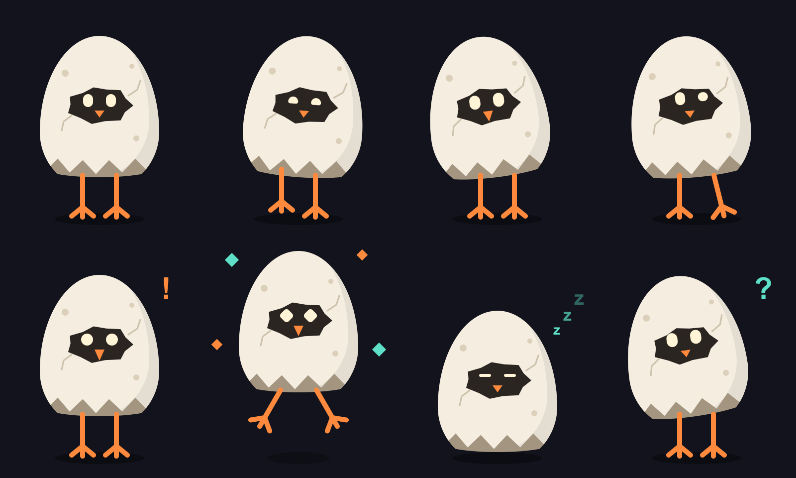

# Optik

Optik, MacBook çentiğinde yaşayan, Türkçe konuşan kişisel bir "ikinci beyin" asistanıdır. "Optik" diye seslenince kümesinden çıkar, "Efendim?" der, söylediğini dinler, işi yapar ve kendi sesiyle yanıt verir. Takvimi, kişileri, dersleri, projeleri, bütçeyi, ilişkiyi ve müşteri siparişlerini tutar, raporlar ve hatırlatıcılarla kendisi haber verir.

Karakteri altı kırık bir yumurta: kırıktan civciv ayakları çıkıyor, kabuktaki çatlaktan gözleri ve gagası görünüyor.



> **Durum:** Aşama 1 (çentik adacığı ve kümes) sürüyor. Yol haritası `docs/04-yol-haritasi.md` içinde.

## Kimin için

Optik tek kişilik bir asistandır ve yalnızca kendi Mac'inde çalışır. Hazır paket dağıtılmaz: depoyu klonla, kendi Apple geliştirici kimliğinle derle, kendi anahtarlarını gir, kendi asistanını kur.

- macOS 14 ve üstü, Apple Silicon
- Çentikli MacBook (çentiksiz ekranda yüzen bir hap olarak görünür)

## Derleme

Gerekenler: Xcode 26 ya da üstü.

```bash
git clone https://github.com/rivalth/optik.git
cd optik
open Optik.xcodeproj
```

Xcode'da `Optik` şemasını seçip çalıştır. Uygulama menü çubuğunda ve çentikte açılır, Dock'ta görünmez. Optik'i çağırmak için ⌘ tuşuna art arda iki kez bas.

⌘ ⌘ kısayolu **Girdi İzleme** izni ister (Sistem Ayarları > Gizlilik ve Güvenlik > Girdi İzleme). Optik yalnızca ⌘ tuşunu izler, başka tuşları okumaz. İzin vermek istemezsen ayarlardan kendi kısayolunu kaydedebilirsin.

Kendi Apple geliştirici hesabınla imzala: Xcode > Settings > Accounts'ta Apple kimliğinle oturum aç (ücretsiz hesap yeter), sonra `Config/Local.xcconfig.example` dosyasını `Config/Local.xcconfig` adıyla kopyala ve ekip kimliğini yaz. Bu dosya depoya girmez. Yapmazsan uygulama yalnızca bu Mac'te çalışacak şekilde imzalanır, ama o zaman macOS her derlemeden sonra Girdi İzleme iznini yeniden ister.

Komut satırından test:

```bash
swift test --package-path Packages/OptikCore
xcodebuild -project Optik.xcodeproj -scheme Optik -destination 'platform=macOS,arch=arm64' test
```

## Gereken hesaplar ve anahtarlar

- Claude API anahtarı.
- ElevenLabs API anahtarı (Optik'in sesi için). Varsayılan ses Jessica hazır bir ses olduğundan ücretsiz plan çalışır; günlük kullanımda aylık karakter hakkı için Starter ya da Creator gerekir. Anahtar yoksa sabit cümleler yine Optik'in sesiyle, diğer yanıtlar sistemin Türkçe sesiyle okunur.
- Uyandırma kelimesi cihaz üzerinde, hesap ya da anahtar istemeyen açık kaynak bir modelle çalışır.

Anahtarlar depoya girmez. Uygulama bunları ilk açılışta sorar ve Keychain'e yazar.

## İçindekiler

| Yol | Ne |
| :-- | :-- |
| `CLAUDE.md` | Claude Code'un her oturumda okuduğu kısa talimat: kararlar, kurallar, performans bütçeleri, git kuralları |
| `docs/01-urun.md` | Optik ne yapar: yüzeyler, bölümler, sipariş kartı, tek cümleyle kayıt, öneri ve rapor kuralları |
| `docs/02-mimari.md` | Teknik yapı: çentik adacığı, ses hattı, LLM, veri, performans, gizlilik, kaynaklar |
| `docs/03-karakter.md` | Karakterin ölçüleri, katmanları, ruh halleri, animasyon ve ses tablosu, renkler |
| `docs/04-yol-haritasi.md` | Aşamalar, kabul kriterleri, verilen kararlar, açık sorular |
| `veri/sema.sql` | SQLite şeması (örnek veriyle sınandı) |
| `veri/ornek-veri.json` | Geliştirme için uydurma örnek veri (tasarımlardaki verinin aynısı) |
| `llm/sistem-istemi.md` | Optik'in kişiliği ve çalışma kuralları, tur bağlamı biçimi, sınama cümleleri |
| `llm/araclar.json` | 27 araç tanımı (Claude araç kullanımı biçiminde) |
| `llm/sabit-cumleler.json` | Önceden seslendirilecek 18 cümle |
| `llm/ses-kimligi.md` | Optik'in sesinin tarifi ve seçim yöntemi |
| `assets/` | Karakter (SVG, PNG), animasyon referansı, kümes, uygulama ikonu seti, arayüz ikonları, ses efektleri, tasarım tokenları |
| `tasarim-kaynak/` | Ekran tasarımlarının kaynak dosyaları (referans) |

Karakterin çalışan referansı için `assets/animasyon/optik-demo.html` dosyasını tarayıcıda aç.

## Katkı

- `main` korumalıdır. Her değişiklik bir dalda yapılır ve PR ile gelir.
- Commit mesajları ve PR başlıkları [Conventional Commits](https://www.conventionalcommits.org/) biçimindedir: `feat(island): add notch panel`.
- Depoya gerçek kişisel veri, anahtar ya da ses kaydı girmez. Her PR'da otomatik sır taraması çalışır.

Ayrıntılar `CLAUDE.md` içindeki "Depo ve git kuralları" bölümünde.

## Lisans

- Kod ve belgeler: [MIT](LICENSE).
- Görseller, karakter, ses efektleri ve ekran tasarımları (`assets/`, `tasarim-kaynak/`): [CC BY 4.0](LICENSE-ASSETS). Kullanırken Optik'e atıf ver.
- Optik'in sabit cümleleri (`assets/sesler/konusma/`): CC BY 4.0 dışında. [ElevenLabs](https://elevenlabs.io) ile üretildi, ElevenLabs koşullarına tabi: yalnızca ticari olmayan kullanım, ElevenLabs atfıyla.
- Yazı tipleri (`Optik/Resources/Fonts/`): Space Grotesk ve Inter, [SIL Open Font License 1.1](Optik/Resources/Fonts/). Lisans metinleri dosyaların yanında.
